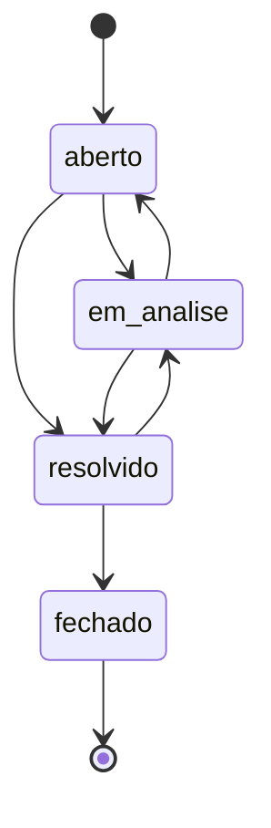

# Modelo de auditoria ITIL — como foi implementado

O enunciado pede um "modelo ITIL de auditoria" sem detalhar quais práticas.
A interpretação abaixo é do grupo e está marcada como **suposição** no
final. Ela usa práticas do ITIL 4 que fazem sentido num estoque de haras.

## Mapeamento prática ITIL → implementação

| Prática ITIL | No EstoqueFácil | Onde |
|---|---|---|
| **Gestão de Incidentes** | Entidade `Incident` com tipo, severidade, responsável, resolução e ciclo de vida (`aberto → em_analise → resolvido → fechado`). Abertura manual por qualquer usuário; triagem e encerramento pelo admin. | `app/models/incident.py`, `app/services/incidents.py`, `/api/incidents` |
| **Monitoramento e Gestão de Eventos** | Os alertas de quebra de estoque são os eventos monitorados: cada insumo é classificado em `ruptura`, `critico`, `atencao` ou `ok`. O evento mais grave (saldo zerado) vira incidente de ruptura automaticamente, e é resolvido sozinho quando a reposição é registrada. | `app/services/alerts.py`, `/api/alerts`, `/api/dashboard`, `incidents.sincronizar_ruptura` |
| **Rastreabilidade (controle de mudanças / auditoria)** | `AuditLog` imutável: quem (usuário), o quê (`action`, `entity`, `entity_id`), quando (`created_at`), de onde (`ip`) e o antes/depois em JSON. Cobre login e login falho, cadastros (create/update/deactivate), movimentações, inventário e incidentes. Não pode ser alterado nem apagado. | `app/models/audit_log.py`, `app/services/audit.py`, `/api/audit` |
| **Gestão de Ativos / Configuração (inventário)** | Contagem física (`InventoryCount`, imutável) comparada ao saldo do sistema. A diferença é corrigida por uma movimentação de ajuste rastreável e gera incidente de divergência. | `app/services/inventory.py`, `/api/inventory` |
| **Medição e Relatórios** | Contagem de incidentes por status e por tipo e tempo médio de resolução; incidentes ativos no painel; registro diário de entradas e saídas. | `/api/incidents/summary`, `/api/dashboard`, `/api/movements/daily` |

## Regras de severidade

| Situação | Severidade |
|---|---|
| Ruptura (saldo zerou) | sempre `critica` |
| Divergência de inventário com \|diferença\| / saldo do sistema ≥ 20% | `alta` |
| Divergência ≥ 5% e < 20% | `media` |
| Divergência < 5% | `baixa` |
| Divergência com saldo do sistema = 0 (não há percentual) | `alta` |
| Abertura manual sem severidade informada | `media` |

Exemplos reais do seed/testes: contagem de 90 sobre 100 → 10% → `media`;
125 sobre 100 → 25% → `alta`; 98 sobre 100 → 2% → `baixa`.

## Ciclo de vida do incidente

- Qualquer outra transição → **409** (`Transição inválida: <atual> -> <novo>`).
- Resolver exige `resolution` → **422** sem ela.
- `closed_at` marca o fim do atendimento: preenchido ao resolver, mantido
  ao fechar, limpo se o incidente for reaberto. O tempo médio de resolução
  usa `closed_at - opened_at` dos incidentes `resolvido` e `fechado`.
- Não se abre um segundo incidente **ativo** (`aberto`/`em_analise`) do
  mesmo insumo e tipo: o serviço devolve o existente (a API responde 409).
- Só o admin muda status, responsável e resolução; o responsável tem de
  ser do mesmo haras.

## Automação

| Gatilho | Efeito (mesma transação) |
|---|---|
| Qualquer movimentação | `AuditLog` `movement` com o snapshot da movimentação |
| Saída que deixa o saldo ≤ 0 | Abre incidente `ruptura` (`critica`, `opened_by` nulo = sistema), sem duplicar |
| Entrada que devolve saldo > 0 | Resolve o incidente de ruptura ativo com `Reposição registrada` |
| Contagem com diferença | Movimentação `ajuste` + incidente `divergencia_inventario` + `AuditLog` `inventory` |
| Login / login falho | `AuditLog` `login` / `login_failed` (falho com e-mail desconhecido fica sem haras) |
| Create / update / deactivate de usuário, categoria, fornecedor e insumo | `AuditLog` com `before_json` / `after_json` (sem senha) |
| Abertura e mudança de incidente | `AuditLog` `incident` com antes/depois |

## Suposições a confirmar com o professor

1. **Quais práticas ITIL** compõem o "modelo de auditoria": adotamos Gestão
   de Incidentes, Monitoramento/Eventos, Rastreabilidade de mudanças,
   Gestão de Ativos (inventário) e Medição. Não implementamos Gestão de
   Problemas (causa-raiz de incidentes recorrentes) nem Gestão de Mudanças
   com aprovação prévia (CAB).
2. **Resolvido x fechado**: o model tem um único carimbo de tempo
   (`closed_at`), usado para o fim do atendimento (resolução). O
   fechamento formal não tem carimbo próprio além da auditoria.
3. **Severidade** pelas faixas de 5% e 20% de divergência e ruptura sempre
   crítica; não há matriz impacto × urgência nem SLA por severidade.
4. **"Incidentes abertos"** no painel conta `aberto` + `em_analise`.
5. **Retenção da trilha**: o `AuditLog` não expira e é imutável pelo ORM. O
   comando `flask seed` (só para dados fictícios) apaga tudo por SQL direto.
6. **Escopo da auditoria**: leituras (GET) não são auditadas; só ações que
   mudam estado, mais login e login falho.
7. A regra de "registro diário de entradas e saídas" e a antecedência de 5
   dias do alerta são decisões do grupo (configuráveis por `.env`).
