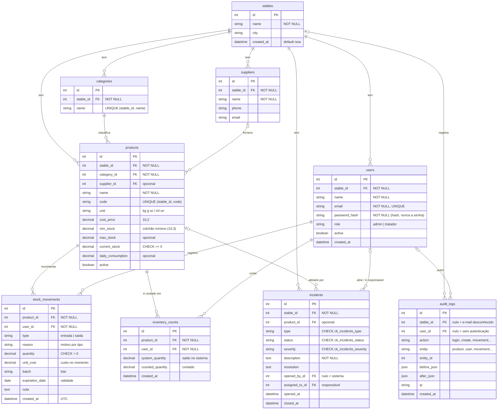

# Modelo de dados (ER)

Banco relacional gerenciado pelo SQLAlchemy (ORM) e versionado pelo
Flask-Migrate/Alembic. Em desenvolvimento usa SQLite; o mesmo código roda
em PostgreSQL trocando `DATABASE_URL`.

Migrations (em ordem):

| Revisão | Nome | O que cria |
|---|---|---|
| `d2b9e292d1e5` | modelo inicial | `stables`, `users`, `categories`, `suppliers`, `products`, `stock_movements`, `inventory_counts` |
| `84631ed584e8` | auditoria_e_incidentes | `audit_logs`, `incidents` (constraints e índices nomeados) |

## Diagrama

## Constraints e índices

| Tabela | Nome | Regra |
|---|---|---|
| `products` | `ck_products_saldo_positivo` | `current_stock >= 0` (o saldo nunca fica negativo nem por bug) |
| `products` | (unique da migration inicial) | `(stable_id, code)` |
| `categories` | (unique da migration inicial) | `(stable_id, name)` |
| `users` | (unique da migration inicial) | `email` |
| `stock_movements` | `ck_movements_quantidade_positiva` | `quantity > 0` |
| `incidents` | `ck_incidents_type` | `type IN ('ruptura', 'divergencia_inventario', 'avaria', 'vencimento', 'furto', 'outro')` |
| `incidents` | `ck_incidents_status` | `status IN ('aberto', 'em_analise', 'resolvido', 'fechado')` |
| `incidents` | `ck_incidents_severity` | `severity IN ('baixa', 'media', 'alta', 'critica')` |
| `incidents` | `ix_incidents_stable_status` | índice `(stable_id, status)` — fila de incidentes |
| `incidents` | `ix_incidents_product_type` | índice `(product_id, type)` — evita duplicar incidente ativo |
| `audit_logs` | `ix_audit_logs_stable_created` | índice `(stable_id, created_at)` — trilha por período |
| `audit_logs` | `ix_audit_logs_entity` | índice `(entity, entity_id)` — histórico de um registro |
| `incidents`, `audit_logs` | `fk_<tabela>_<coluna>` | todas as FKs das tabelas novas têm nome (SQLite em batch mode) |

As três unique constraints sem nome vêm da migration inicial, que não foi
reescrita (decisão do grupo: mudanças entram em migrations novas por cima).

## Entidades

| Entidade (tabela) | Model | Para que serve |
|---|---|---|
| Haras (`stables`) | `Stable` | Cliente/propriedade. Tudo é isolado por `stable_id`: um haras nunca vê dados de outro. |
| Usuário (`users`) | `User` | Admin (gestão) ou tratador (operação). Senha guardada só como hash (Werkzeug). |
| Categoria (`categories`) | `Category` | Ração, Volumoso, Suplementos, Vitaminas... nome único por haras. |
| Fornecedor (`suppliers`) | `Supplier` | Quem vende o insumo (opcional no produto). |
| Insumo (`products`) | `Product` | Item de estoque. `min_stock` é o colchão mínimo (quebra de estoque); `daily_consumption` permite calcular a cobertura em dias. O saldo só muda por movimentação. |
| Movimentação (`stock_movements`) | `StockMovement` | Entrada ou saída imutável, com motivo, custo do momento, lote e validade. Base do registro diário. |
| Contagem (`inventory_counts`) | `InventoryCount` | Inventário físico: saldo do sistema x contado. Imutável. |
| Incidente (`incidents`) | `Incident` | Gestão de incidentes (ITIL): ruptura, divergência, avaria... com ciclo de vida e severidade. |
| Auditoria (`audit_logs`) | `AuditLog` | Trilha imutável de quem fez o quê, com antes/depois em JSON. |

Os valores aceitos em campos de domínio (motivos, unidades, papéis, níveis,
tipos/status/severidade de incidente, ações de auditoria) ficam em
`app/models/constants.py` e são expostos ao front-end por `GET /api/meta`.
